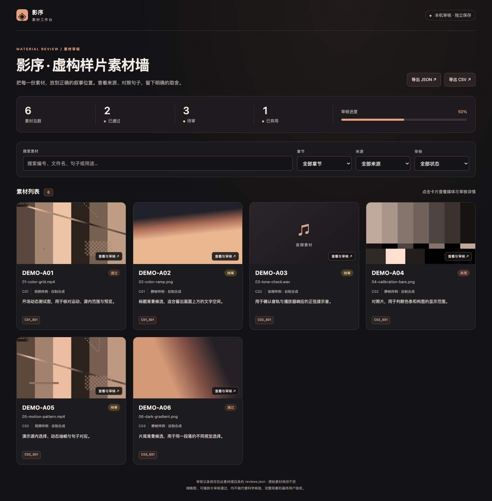
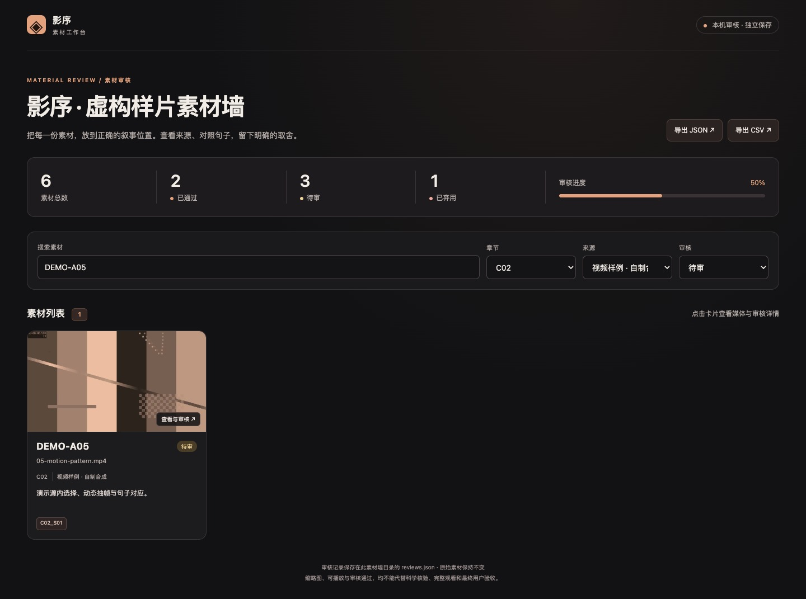
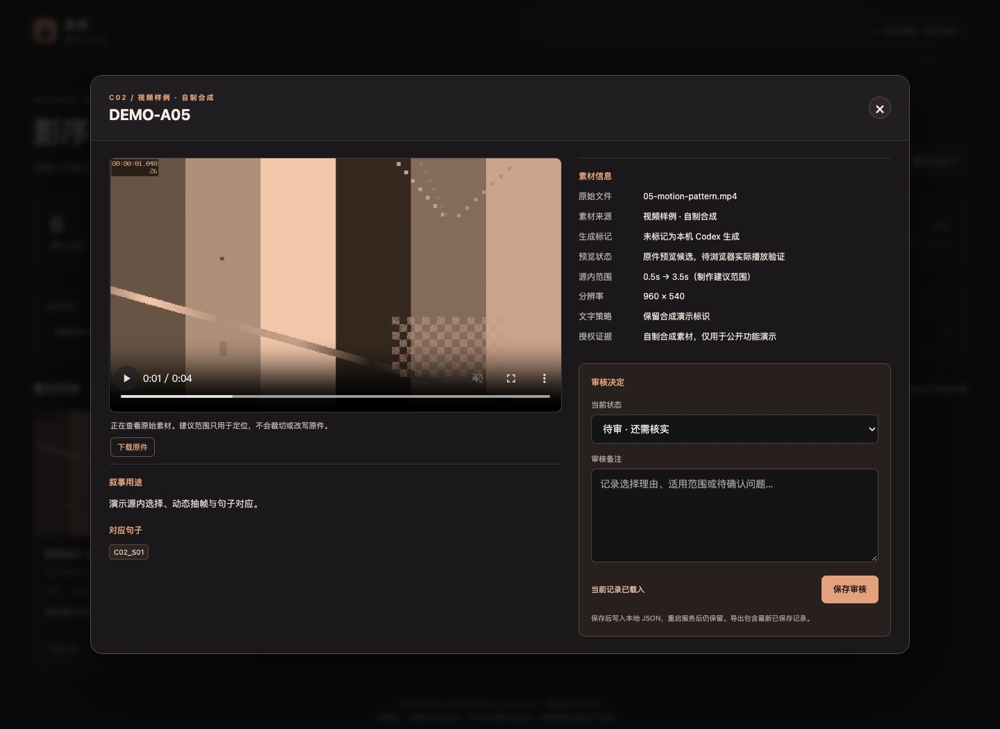

# 功能说明与操作示例

本页对应公开版 **v1.2.0**。各模块可以独立运行，也可以按下述顺序连接。通用智能体工具提供素材盘点、工程检查和媒体探测。[智能体接入](agent-integration.md) · [功能实拍](screenshots/README.md)

所有命令默认在 `skills/science-achievement-film/` 目录执行。`/path/to/project` 是使用者自行选择的新项目目录，不是预置目录。输出一般要求新文件或新目录，以免覆盖已经确认的版本。模板中的文案、素材路径与测量值应替换为本项目真实内容。

## 1. 项目策划与版本控制

**解决的问题：** 长视频容易出现改错底版、已确认片头被重做、时长失控、局部配音修改扩大成全篇重录。

**输入：** 当前项目简报、用户修改要求、已确认文件、最新文稿、实际时长与制作规格。

**提供：** 策划和审定方法；项目初始化；资料盘点；计划检查；已冻结文件的哈希核对。支持用稳定句子编号连接文稿、声音和镜头。

```bash
python3 scripts/filmkit.py init /path/to/project --chapters 3 --max-seconds 300 --fps 25
python3 scripts/filmkit.py inventory /path/to/project/media --out /path/to/project/inventory.json --probe
python3 scripts/filmkit.py check /path/to/project/project.json --out /path/to/project/plan-check.json
```

`init` 创建制作目录和计划模板；`inventory` 输出文件清单；`check` 输出时长、必填项、保护词边界和冻结文件等检查结果。**未知时长不会填成零或假定通过**。这些检查不证明内容准确，也不会自动生成经过审定的商业脚本。

详细规则：[策划与审核](../skills/science-achievement-film/references/planning-review.md)、[计划数据规范](../skills/science-achievement-film/scripts/filmkit-schema.md)。

## 2. 文档提取与旁白稿导出

**输入：** DOCX、PPTX、PDF、TXT、Markdown、CSV，以及整理后的 `manuscript.json`。

**提供：** DOCX段落与表格提取、PPTX实际幻灯片顺序与动画存在标记、PDF文本提取；保留来源定位和源文件哈希。文稿区分事实文本、口播文本、TTS输入和屏显文本，可导出全篇与逐章可编辑DOCX、Markdown和JSON快照。

```bash
python3 scripts/content_tools.py ingest /path/to/project/report.docx --document-id DOC01 --out /path/to/project/report.json
python3 scripts/content_tools.py manuscript /path/to/project/manuscript.json --out-dir /path/to/project/narration-v1
python3 scripts/content_tools.py to-project /path/to/project/manuscript.json --out /path/to/project/checked-plan.json
```

**输出：** 结构化资料、完整及分章旁白文档、可交给计划检查器的快照。`to-project` 不会冒充编辑器时间线；仍须补实测时间、镜头和冻结范围。

**边界：** PDF需要`pdftotext`；复杂公式、文本框、扫描页和PPT动画不能只靠文本提取验收。工具不会根据几句资料自动编造科学成果，也不自动把文件中嵌入的指令当用户授权。

详细说明：[文稿与交接](../skills/science-achievement-film/references/archive-and-content.md)。

## 3. 素材盘点、抽帧与重复候选

**输入：** 本机已下载且有权使用的视频、图片、音频。

**提供：** 流参数探测、按间隔抽帧、接触表、场景切点候选、完全相同文件哈希、抽样画面近重复候选。辅助全量梳理素材，区分文件存在、可解码、已观看和已获准使用。

```bash
python3 scripts/media_tools.py probe /path/to/project/media/source.mp4 --output /path/to/project/probe.json
python3 scripts/media_tools.py frames /path/to/project/media/source.mp4 --every 2 --count 48 --output /path/to/project/frames
python3 scripts/media_tools.py candidates /path/to/project/media/a.mp4 /path/to/project/media/b.mp4 --output /path/to/project/candidates.json
```

**输出：** JSON探测报告、JPG帧与接触表、切点/重复候选报告。

**边界：** 需要FFmpeg/ffprobe。候选不是自动删除清单；抽样可能漏掉运动、字幕差异或短暂细节。人脸、科学意义和最佳镜头需要实际观察，不能只比较像素。

详细说明：[本地媒体工具](../skills/science-achievement-film/references/local-media-tools.md)、[真实视频分析方法](../skills/science-achievement-film/references/integrations/local-video.md)。

## 4. 旁白与画面的语义交接

**输入：** 带稳定句子编号的 `manuscript.json` 与带源路径、入出点和用途理由的 `shots.json`。

```bash
python3 scripts/content_tools.py handoff /path/to/project/manuscript.json /path/to/project/shots.json --out /path/to/project/wall-input.json
```

**输出：** 可以直接构建素材墙的清单。检查句子编号、对应关系、源内范围与素材引用；相对路径按原始清单所在目录解析。

**边界：** 脚本验证“连接是否存在、字段是否有效”，不自动证明“画面真的解释了这句话”。需结合完整播放、来源资料和审核备注判断。切换配音后应重新对齐时间，不能沿用旧版时间点。

## 5. 可播放的素材墙

这是包内完整提供的前台功能，页面HTML/CSS/JavaScript和Python服务源码均已内置，无需云账号或数据库。以下截图来自**真实运行界面**，其中素材是自产几何图形与程序动画；不是实际科研成果或生成模型质量展示。

### 5.1 总览、来源与审核进度

用卡片查看缩略图、章节、来源、句子编号、用途与备注。顶部统计通过、待审、弃用和审核进度。只有清单明确指定 `local_codex_generated=true` 才显示“AI · 本机 Codex 生成”。示例中的标记仅演示本工作流主动制作的程序动画，不代表调用了某个生成模型。



### 5.2 组合筛选与搜索

可按关键词、章节、来源和审核状态组合筛选。截图将六份候选缩小到一份，方便逐项核对。



### 5.3 媒体预览与原件保护

打开卡片可预览图片、视频或音频，查看分辨率、源内建议范围、文字策略和授权记录。视频支持正常播放与定位。浏览器不支持的格式可在构建时明确开启代理转换；已有预览优先复用。代理保持完整时长和视场，原件不变。



### 5.4 审核保存与交接导出

选择“通过 / 待审 / 弃用”，填写理由并保存。页面明确显示“已保存到本地”后才算写入成功。审核结果保存在墙目录内的 `reviews.json`，刷新或重启服务后可继续使用。导出JSON/CSV包含最新已保存记录，可交给后续剪辑或继续审阅。


### 构建和启动

```bash
python3 scripts/material_wall.py build /path/to/project/wall-input.json --output /path/to/project/wall-v1 --thumbnails --proxies
python3 scripts/material_wall.py serve /path/to/project/wall-v1 --port 8765
```

在浏览器打开 `http://127.0.0.1:8765/`，从动态首页点「进入素材墙」。需要把素材墙和媒体一起搬迁时，在构建命令加 `--copy-media`。下次可用同一条 `serve` 命令继续审核。

**输出：** 完整本地页面、清单、审核记录、媒体白名单、可选缩略图与代理。**边界：** 本机单用户服务，监听回环地址，无公网发布、账号管理和多人合并；项目运行目录可能含本机路径，不属于插件公开源代码。

完整字段、安全边界和恢复方法：[素材墙使用手册](../skills/science-achievement-film/references/material-wall.md)。

## 6. 旁白、读音、停连和配音修订

**提供：** 参考片声音分析、专名/数字单位保护、术语读音表、标点停连设计、短样确认、局部重录与声音衔接方法；VoiceStudio REST/MCP的调用、转写和失败恢复步骤已内置。

**输入：** 审定旁白、术语表、声音授权、已安装的语音服务与实际可用声线。

**输出：** 通过外部引擎得到的声音文件、实测时间码、听审记录；再由本包混音工具制作有BGM/无BGM版本。

**边界：** 本包不附TTS模型、他人声音样本或账号，不提供“自动完美复刻”保证。读音、气泡音、卡顿和情绪必须试听。已有确认范围优先保留，重录不能无故扩大。ASR文本正确也不代表声音自然。

入口：[旁白制作](../skills/science-achievement-film/references/narration-audio.md)、[语音调用方法](../skills/science-achievement-film/references/integrations/voicestudio.md)。

## 7. 视频生成、摄影节奏和几何控制

**提供：** 生成镜头的输入准备、参考限制、提示词模板、摄影/灯光/节奏方法、任务账本，以及Seedance最小HTTP客户端的离线校验、明确提交、查询和下载。Blender/FreeCAD的几何约束与导出工作流也已内置。

**输入：** 已确认的科学结构、参考图片、明确生成缺口、预算、当前服务支持的模型与规格。

**输出：** 镜头提示词、参考和几何约束、服务任务ID及下载文件；通过结构与画面审核后才进入剪辑。

```bash
python3 references/integrations/seedance_http.py --help
python3 scripts/runtime_tools.py --help
```

**边界：** 生成服务、模型、凭据和建模软件由使用者配置。内置HTTP客户端限定文档列明的官方主机，不自动接受代理或其他区域；失败或超时先查原任务，避免重复收费。不会把不明结构补成事实，也不把放大后的1080p文件称为原生4K。

入口：[Seedance](../skills/science-achievement-film/references/integrations/seedance.md)、[摄影与节奏](../skills/science-achievement-film/references/integrations/cinematic-rhythm.md)、[几何/文档/OCR](../skills/science-achievement-film/references/integrations/geometry-documents.md)。

## 8. 字幕、标题与独立包装层

**输入：** 经核对的文本与实测开始/结束时间，画布、字体和标题位置。

```bash
python3 scripts/media_tools.py subtitles /path/to/project/subtitle-timing.json --output /path/to/project/subtitles-v1
```

**输出：** SRT字幕与可编辑ASS文件；标题和字幕使用独立样式层，便于修改名称、单位与排版，不需要重生成底图。

**边界：** 此模块不自动识别语音；输入时间来自ASR/实际听审。烧录需要支持libass的FFmpeg和实际存在的中文字体；必须检查缺字、安全区、长标题与画面遮挡。复杂三维标题和原生编辑器包装按后期方法制作。

## 9. 剪辑、混音和分项导出

**输入：** 显式 `edit.json` 或音频配方，包括源片段、入出点、静态图时长、画布、字幕、音轨和章节范围。

```bash
python3 scripts/media_tools.py render /path/to/project/edit.json --output /path/to/project/film-v1
python3 scripts/media_tools.py audio /path/to/project/audio.json --output /path/to/project/audio-v1
```

**提供：** 等比适配、片段拼接、淡入淡出、字幕烧录、配音与BGM时间编排、音量与循环、明确区间压低背景音乐、限幅、保留时长的指定区间静音。按章节范围输出完整片和独立分项片。

**边界：** 默认保持原视场，不以局部裁切伪装清晰度。保时静音需要先确定确实是杂音的区间，不能自动抹掉字音。脚本是基础合成工具，不代替完整非线性编辑器；复杂稳像、调色、精细转场和原生工程仍使用指定后期软件。

配方字段与示例：[媒体工具](../skills/science-achievement-film/references/local-media-tools.md)、[剪辑模板](../skills/science-achievement-film/assets/edit-recipe.example.json)。

## 10. 达芬奇调色、稳像与原生渲染

**提供：** 本包独立的操作流程与当前接口核对方法，包括独立工程、素材导入、时间线、波形/RGB Parade、白平衡/曝光/饱和度、分节点A/B、字幕/标题层、安全区、弱稳像及裁切检查、保存重开、Deliver参数和渲染核验。

**输入：** 剪辑方案、源素材、实测声音、字幕与本机已安装的DaVinci Resolve和所需API/MCP运行环境。

**输出：** 在原生软件内实际完成后保存的工程、必要中间片、成片和验收记录。

**边界：** 包含操作方法，不包含商业软件、MCP服务端本体或许可证。本轮公开包测试没有执行真实工程调色、稳像或渲染；不能将FFmpeg输出写成“已达芬奇调色”。功能可用性和界面状态在执行时重新检查。

完整方法：[达芬奇操作](../skills/science-achievement-film/references/integrations/davinci.md)。

## 11. 技术QC与真实验收

```bash
python3 scripts/media_tools.py qc /path/to/project/film-v1/film.mp4 --output /path/to/project/qc.json
```

**输出：** 媒体参数、完整解码结果、黑场与冻结候选。辅以逐章边界、语义、字幕、声音和正常速度播放的人工/智能体检查表。

**边界：** 黑场可能是创意设计，静止可能是合理读图时间；自动候选不直接判定缺陷。技术解码、播放器观看、声音听审、科学核验和用户接受分别记录，任何一项都不能替代其他项。

入口：[QC清单](../skills/science-achievement-film/assets/qc-checklist.md)、[后期与交付](../skills/science-achievement-film/references/post-qc-archive.md)。

## 12. 依赖归档、迁移和获准清理

**输入：** 已审定的依赖列表及明确清理范围。

**提供：** JSON/Python/DRP里的路径候选发现、独立文件复制、源与副本哈希、路径映射、JSON迁移、归档校验；清理先生成计划，再按精确计划哈希进入可恢复隔离，支持恢复与经确认清除。

```bash
python3 scripts/archive_tools.py create /path/to/project/archive-plan.json --out /path/to/new-archive
python3 scripts/archive_tools.py verify /path/to/new-archive
python3 scripts/archive_tools.py --help
```

**输出：** 可核验的归档目录、manifest与映射、清理/恢复记录。不会把动态依赖候选当完整依赖保证，也不会因项目完成自动删除原素材。真正迁移还需在原路径不可用的条件下重开工程和核验输出。

完整规范和危险操作边界：[归档工具](../skills/science-achievement-film/references/archive-and-content.md)。

## 13. 环境诊断与中断恢复

```bash
python3 scripts/runtime_tools.py doctor --config assets/runtime-config.example.json
```

检查实际选中的可执行文件、FFmpeg过滤器、OCR语言和相关文件；可显式检查已配置的本机服务。任务账本记录请求摘要、状态、外部任务ID与输出证据，支持恢复后查询原任务。

不自动安装软件、下载模型、启动GUI或提交收费任务。路径存在、服务健康、生成成功和效果验收是不同状态。凭据由用户环境提供，不写进发布包、日志或截图。

## 14. 开源打包与完整演示

**公开工具完整保留**；环境专用配置不属于公开包。版本标记、白名单和隐私检查避免将本机发行内容误打包。截图只能证明界面操作，发布前还需看图检查隐私与授权。

```bash
python3 scripts/demo_project.py --output /path/to/new-demo --ffmpeg /path/to/full/ffmpeg --font "Noto Sans CJK SC"
```

演示自产测试图和低音量正弦音，实际跑通文稿、待审素材墙、字幕标题、2.4秒短片与分项片、技术QC、归档和校验；不包含真实配音、科学成果或付费调用。字体与FFmpeg参数按本机已有环境调整。

公开打包在仓库根目录执行：

```bash
python3 skills/science-achievement-film/scripts/public_release.py scan .
python3 skills/science-achievement-film/scripts/public_release.py build . --out ../award-video-production-v1.0.0.zip
```

白名单包不含Git历史或运行输出；本机版标记会直接阻止公开打包。工具不会自行发布到GitHub。

## 依赖与验收速查

| 部分 | 需要的外部运行条件 | 当前可核验范围 |
|---|---|---|
| 文稿/计划/归档/素材墙基础 | Python、现代浏览器 | 自动回归与虚构流程验证 |
| 媒体/代理/字幕/混音/QC | FFmpeg、ffprobe；字幕需libass和字体 | 合成媒体真实执行、完整解码 |
| 素材墙界面 | 回环HTTP服务与浏览器 | 筛选、6秒视频播放、保存、刷新持久化及截图 |
| PDF/OCR/ASR | pdftotext、OCR/语音引擎等按需安装 | 方法内置；具体文档和声音另验 |
| 视频生成/配音 | 用户配置模型、服务、授权和余额 | 离线接口/任务测试；未做付费生成验收 |
| 原生建模/达芬奇 | 对应应用与API/MCP运行环境 | 工作流内置；真实项目需实际操作验收 |

测试命令与范围见[验证说明](../skills/science-achievement-film/references/verification.md)。这份说明与代码同版本维护，不将未来计划列为已具备功能。
