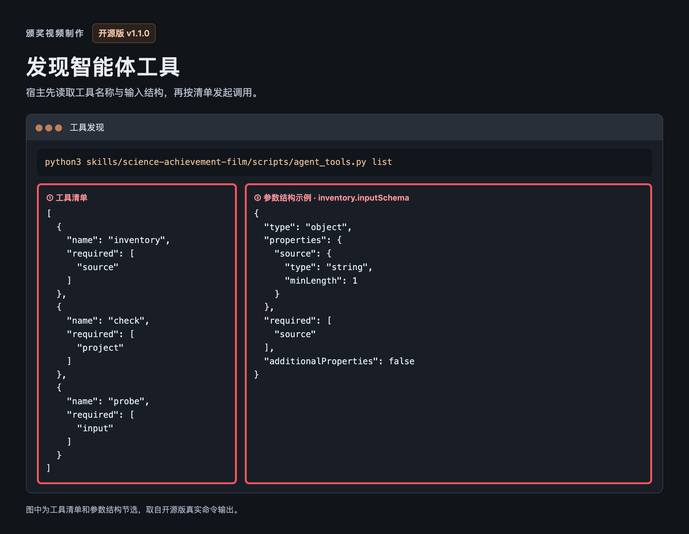
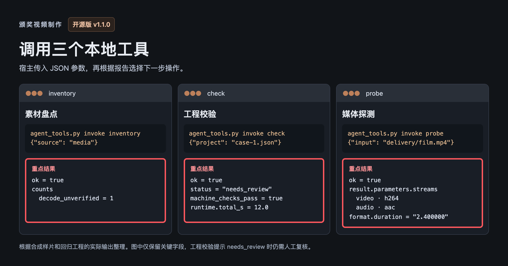

# 颁奖视频制作 v1.1.0

相比 v1.0.0，新增了通用智能体入口。能启动本地进程的宿主可以发现工具、传入 JSON 参数，并读取结构化结果。Codex 用户可继续使用原有插件和 Skill。 [智能体接入说明](agent-integration.md)

## 新增功能

**工具发现。** `agent_tools.py list` 返回三个工具的名称、用途和输入结构。图中红框标出工具列表及 `inventory` 的参数要求。

**结构化调用。** `inventory` 盘点素材，`check` 校验工程并返回发现，`probe` 读取媒体流的编码与时长。下图整理自合成样片和回归工程的实际命令结果。红框标出宿主收到的关键数据，完整返回结构见接入说明。

## Bug 修复

- 修复发布 ZIP 输出到 `docs/` 等公开打包路径时，打包器会把正在写入的 ZIP 收录进自身的问题。现在会在创建文件前拒绝该输出位置，并提示把 ZIP 放到公开源码路径之外。

## 下载与验证

Release 提供源码工具 ZIP 及 SHA-256 校验文件。媒体探测和渲染需要本机 FFmpeg 与 FFprobe。

86 项单测和 31 项回归通过。已从最终 ZIP 解包验证智能体工具，并用合成素材验证导出、浏览器完整播放和素材墙审核记录保存。
