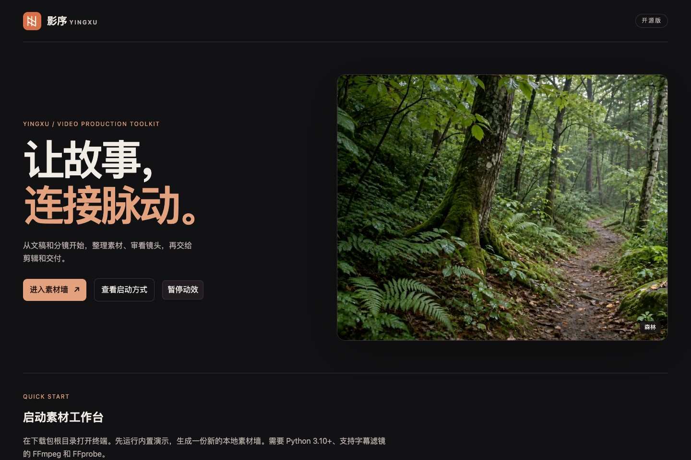
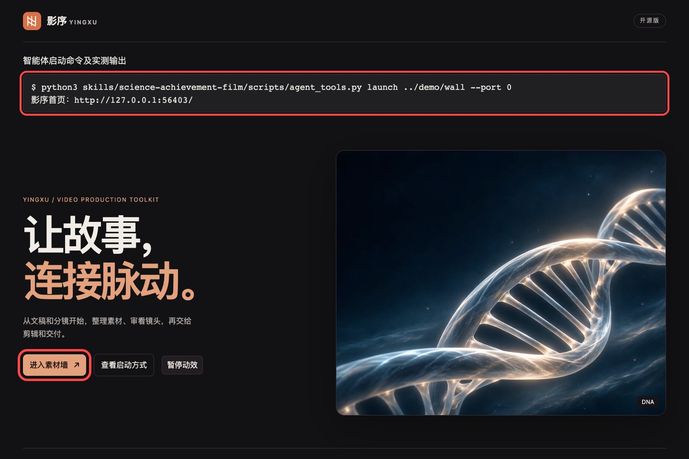

# 影序开源版 v1.2.0

相比 v1.1.0，本版加入 18 景动态首页，并修复从下载包或智能体启动后直接进入素材墙的问题。

## 新增 18 景随机播放

每次进入首页，从当前轮尚未播放的画面中随机抽取一景，静音循环。18 景各出现一次后重新洗牌，新一轮避开刚播过的画面。画面和首帧都随 ZIP 附带，可离线查看。支持暂停动效、系统减少动态效果及视频加载失败时显示首帧。[画面来源](home-cover-assets.md)

## 修复启动跳过首页

解压后双击 `打开影序.html` 先看首页。已有素材墙时，Codex Skill 和其他能启动本地进程的智能体可通过 `agent_tools.py launch` 打开工作台首页，再由用户点击「进入素材墙」。红框标出实际运行的命令、返回的首页地址及进入素材墙的按钮。[智能体接入](agent-integration.md)

## 下载与验收

[下载 v1.2.0 源码 ZIP](https://github.com/zcxpub-cmd/award-video-production/releases/download/v1.2.0/award-video-production-v1.2.0.zip) · [SHA-256 校验文件](https://github.com/zcxpub-cmd/award-video-production/releases/download/v1.2.0/SHA256SUMS.txt)

88 项单测和 31 项回归通过。在 macOS 的 Chrome 中从解压包验证了两轮 18 景不重复、换轮不连播、离线首页、智能体启动、素材墙审核保存和 JSON 导出。18 段视频均通过完整解码。[与 v1.1.0 比较](https://github.com/zcxpub-cmd/award-video-production/compare/v1.1.0...v1.2.0)
