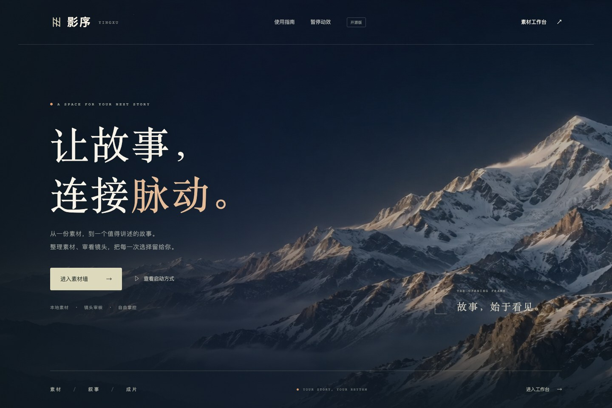
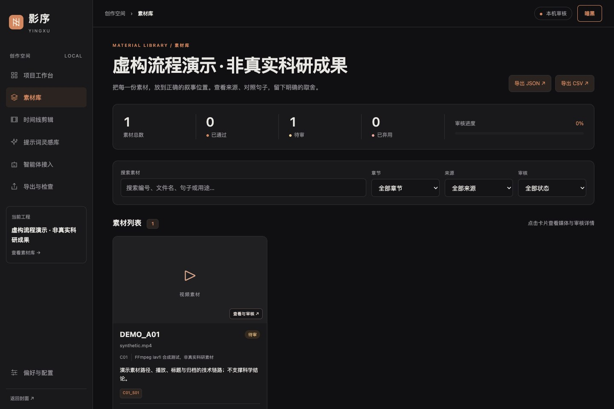
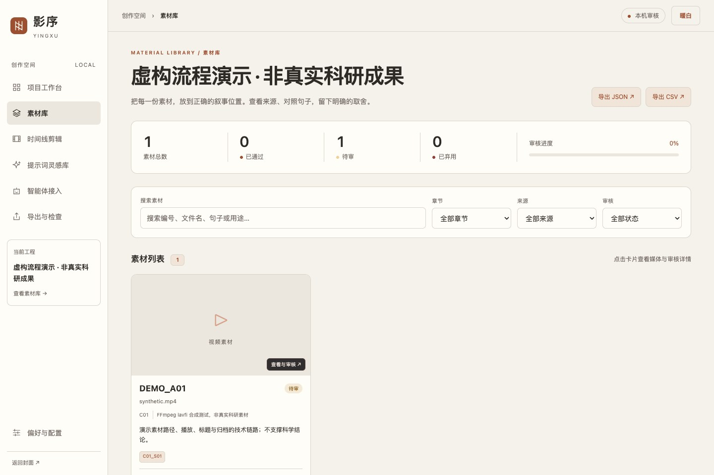
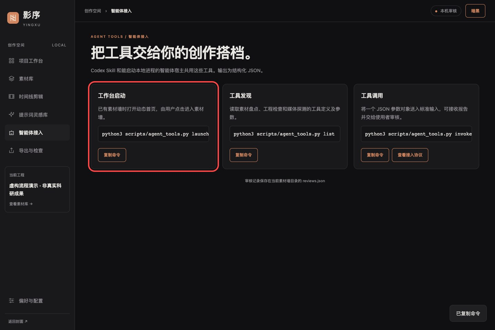

# 影序开源版 v1.3.0

## 全屏动态首页

开源版采用与本地版相同的全幅视频、遮罩、标题和页脚布局。18 景仍然按轮随机播放，同一轮内不重复。解压双击 `打开影序.html` 可看首页，启动本机工作台后从首页点「进入素材墙」。

## 工作台界面

素材库、项目工作台、时间线剪辑、提示词灵感库、智能体接入、导出与检查、偏好与配置沿用同一套导航和视觉样式。内页支持暗黑和暖白，选择在当前浏览器保存。可在浏览器完成素材审核和审核记录导出。剪辑、混音、渲染和外部生成沿用开源命令工具，功能页提供对应入口。

## 智能体启动入口

在智能体接入页可以复制 `agent_tools.py launch` 命令。启动后浏览器先打开动态首页。红框标出启动命令及复制按钮。

## 下载与验证

[下载 v1.3.0 源码 ZIP](https://github.com/zcxpub-cmd/award-video-production/releases/download/v1.3.0/award-video-production-v1.3.0.zip) · [SHA-256 校验文件](https://github.com/zcxpub-cmd/award-video-production/releases/download/v1.3.0/SHA256SUMS.txt)

在 macOS 的 Chrome 中，以同一景和相同视口对照本地版的裁切、滤镜和标题位置。实测两轮无重复、审核保存、JSON 和 CSV 导出、七个工作台页面、主题刷新保留及 390px 窄屏。88 项单测、31 项回归通过。
