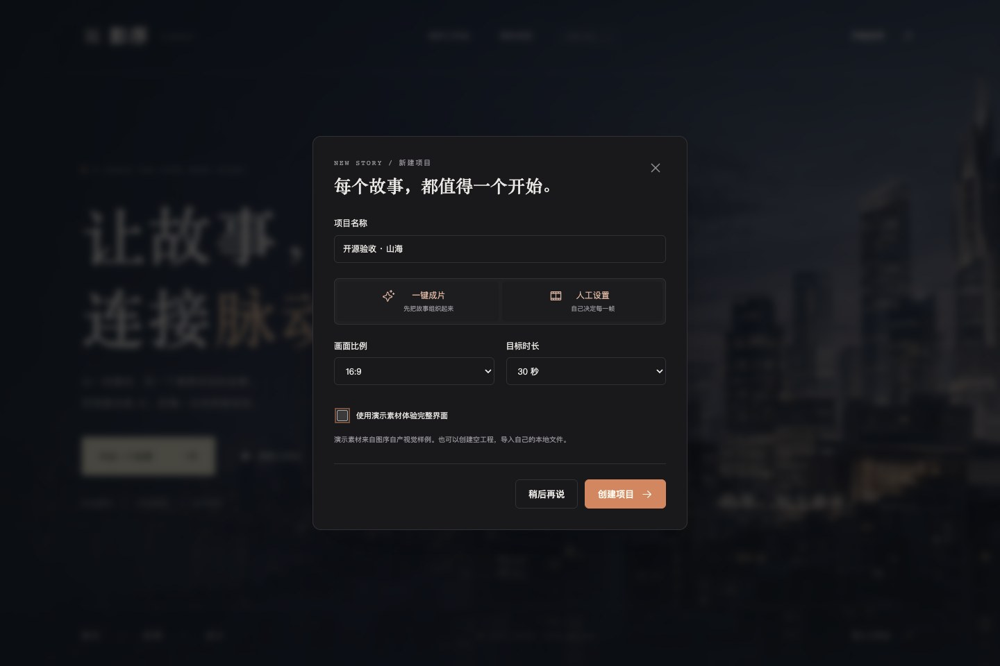
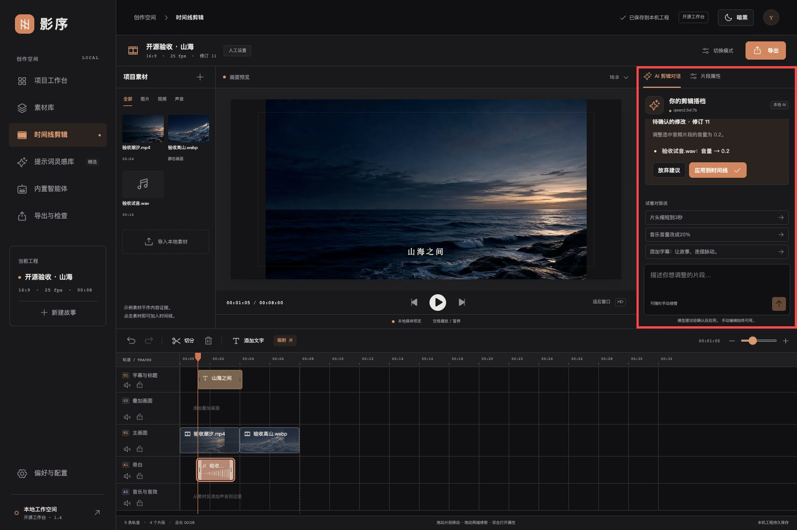
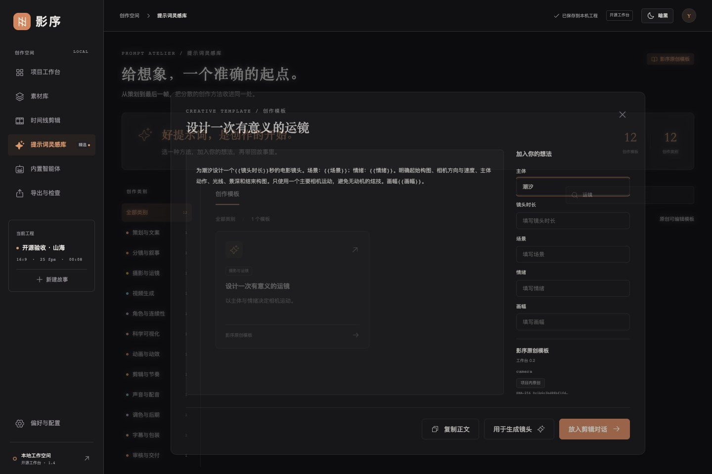
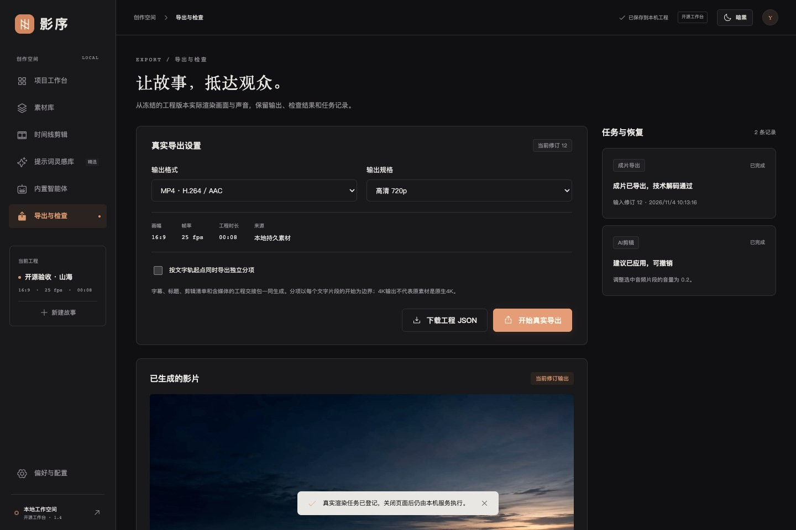

# 影序开源工作台 v1.4.0

解压发行 ZIP 后，通过平台启动器进入实际制作工作台。需要 Python 3.10 或更新版本。首次联网安装专用 Python 环境和所需媒体组件，随后自动打开 18 景动态首页。工程保存在自己的用户目录。[安装与使用](使用说明书.md)

## 从新建项目到实际剪辑

可创建空白工程或选择演示素材，使用人工设置与一键成片。导入图片、视频和音频，编辑五轨时间线，保存后可继续操作。支持修剪、调整位置、标题、声音、撤销和重做。

## 提示词模板与内置智能体

12 个原创模板可搜索、填变量、复制、带入剪辑对话或生成表单。内置导演总控、素材观察员、剪辑编排师和质量审核员。规划、观察和对话剪辑使用用户配置的本机 Ollama 模型，FFmpeg 负责技术检查。红框标出实测的 AI 剪辑建议和确认入口。

## 导出与兼容

可导出 MP4、MOV、字幕、剪辑清单和可导入的工程交接包。保留旧素材审核墙与原命令行接口。智能体宿主使用 `agent_tools.py studio` 启动工作台。

本次在 Apple 芯片 macOS 上从解压包验证首次安装、人工工程、三类素材导入、多轨编辑、模板填充、真实 Ollama 建议确认、导出及浏览器播放。Windows 和 Linux 提供启动脚本。收费生成适配按服务商账户和单次确认配置。
